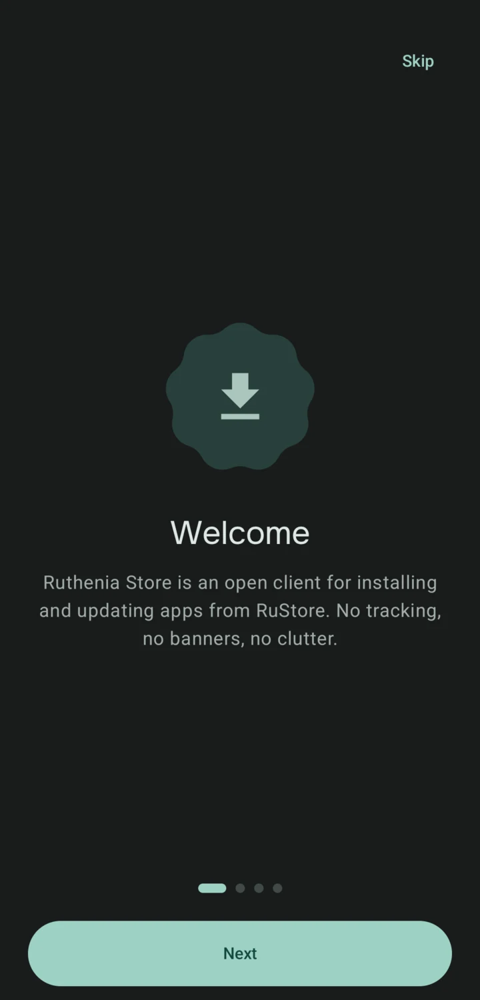
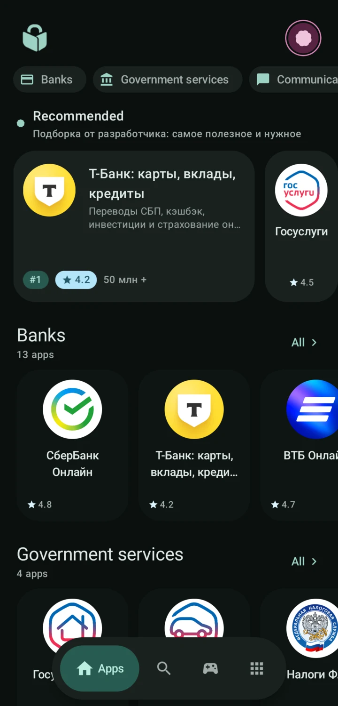
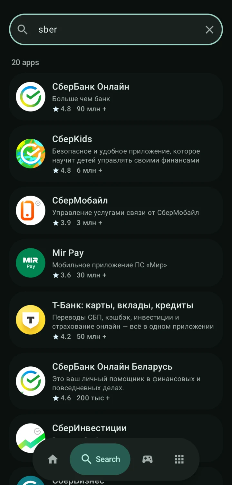
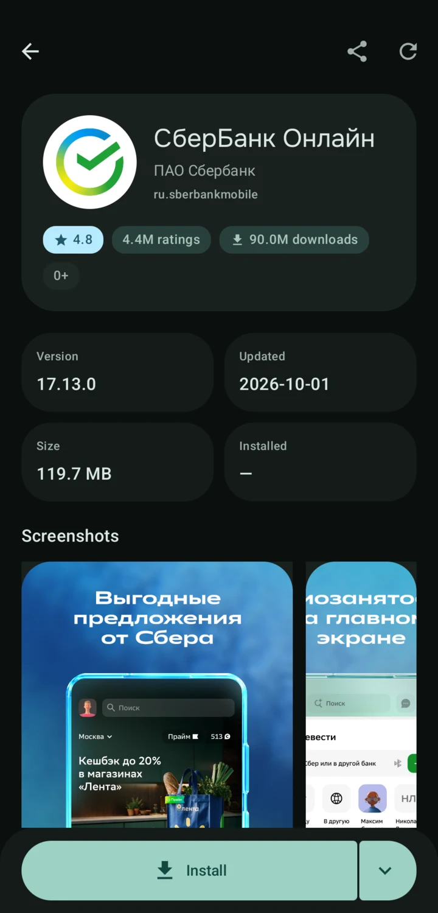
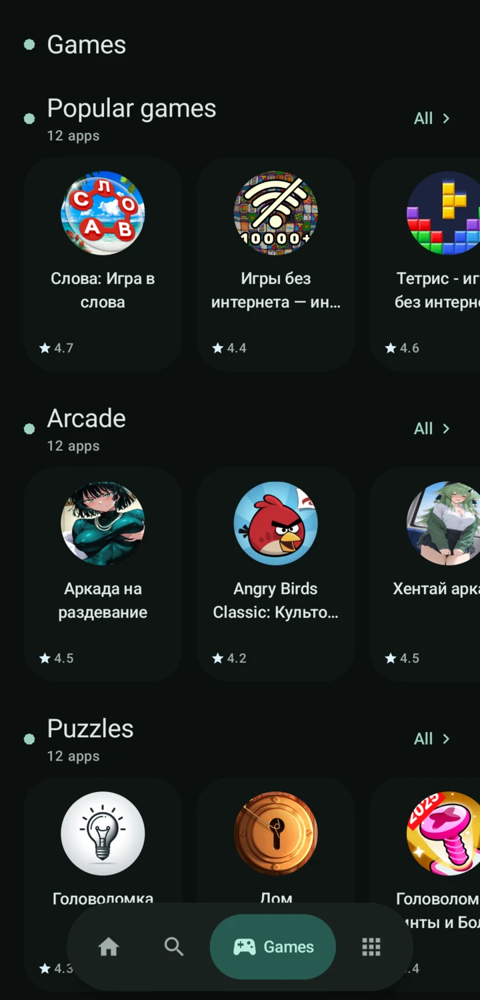
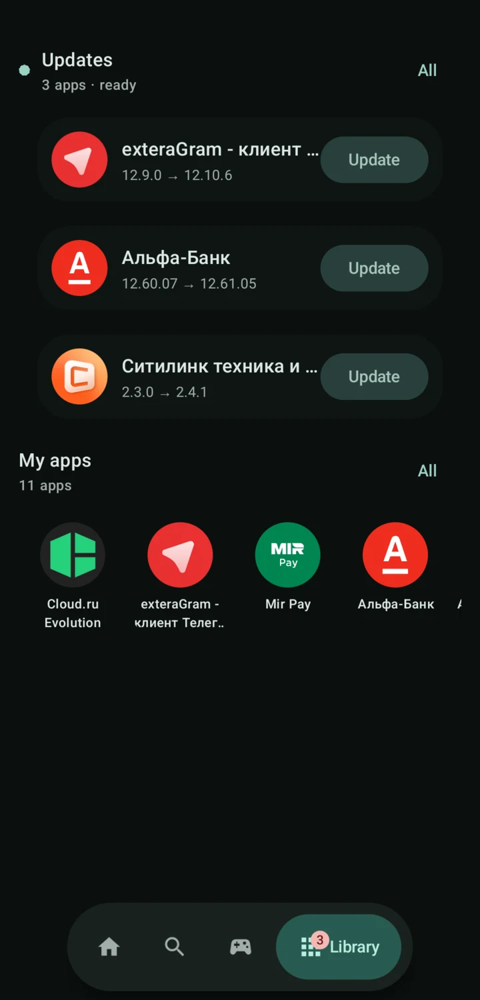
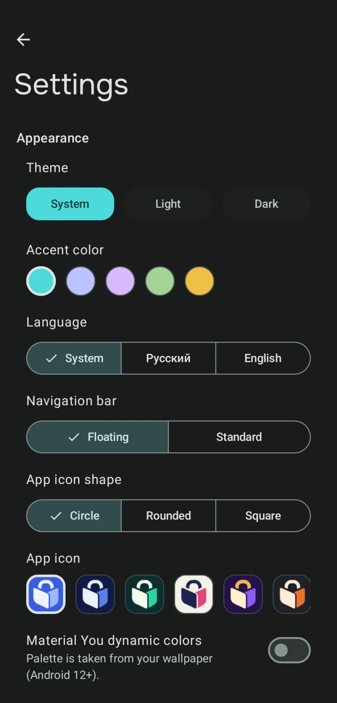
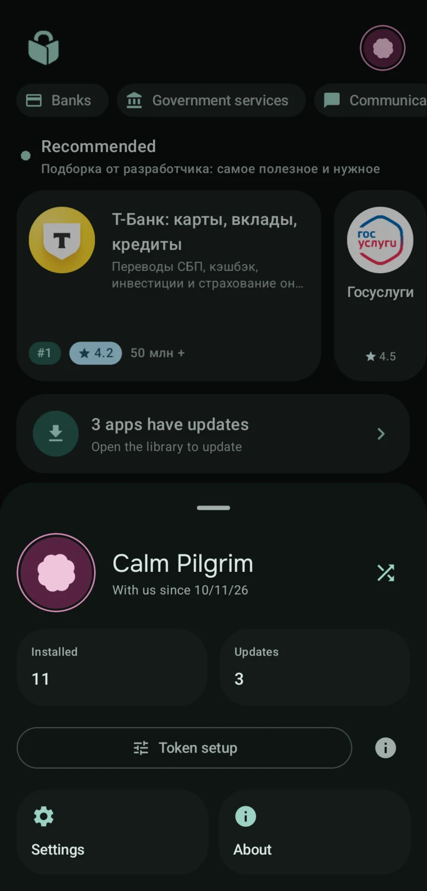

### Ruthenia Store

[](LICENSE)
[](https://kotlinlang.org)
[](https://developer.android.com)

[Русская версия здесь!](README.ru.md)

**A lightweight, private RuStore client. Written from scratch. No tracking, no ads, no bloat.**

Ruthenia Store lets you install and update apps from the RuStore catalog (banks, government services and other Russian services) without the official app — no trackers, no nagging updates, no cluttered interface.

---

## Download

Grab the latest APK from the [Releases page](https://github.com/venterum/ruthenia/releases). Requires Android 8.0 (API 26) or newer.

---

## What's inside?

- **Search** the RuStore catalog by name or package name
- **Home feed** — "Recommended" plus category sections (banks, government services, games, etc.)
- **Games page** — popular games and genre feeds (can be hidden in settings)
- **App details** — screenshots, "what's new", rating, "More from developer"
- **Install and update** — split-APK support, a single install session, background downloads via WorkManager, pause/resume and a download manager with recovery actions in the Library
- **Live Updates** — active download progress appears as a promoted ongoing notification on Android 16+ (lock screen and status-bar chip)
- **Silent install via Shizuku** — optionally installs APKs without the system dialog (off by default, signature verification still applies)
- **Device token** — a locally generated identity (name, motif, colour, frame) instead of an account; it never leaves the device
- **Launcher icon** — pick the app icon colour in settings; themed (monochrome) icons keep working
- **Library** — installed apps with update status, batch update, import from device
- **Certificate refresh** — manual re-check of SPKI pins against live RuStore chains and the official Mintsifry CA
- **Privacy above all** — no analytics, crash reporting or ad SDKs, anonymous operation, signature verification on every update

---

## Screenshots

<table>
  <tr>
    <td align="center"><a href="docs/screenshots/en/01-onboarding.webp"></a><br><sub>Onboarding</sub></td>
    <td align="center"><a href="docs/screenshots/en/02-home.webp"></a><br><sub>Home feed</sub></td>
    <td align="center"><a href="docs/screenshots/en/03-search.webp"></a><br><sub>Search</sub></td>
    <td align="center"><a href="docs/screenshots/en/04-app.webp"></a><br><sub>App details</sub></td>
  </tr>
  <tr>
    <td align="center"><a href="docs/screenshots/en/05-games.webp"></a><br><sub>Games</sub></td>
    <td align="center"><a href="docs/screenshots/en/06-library.webp"></a><br><sub>Library and updates</sub></td>
    <td align="center"><a href="docs/screenshots/en/07-settings.webp"></a><br><sub>Settings</sub></td>
    <td align="center"><a href="docs/screenshots/en/08-token.webp"></a><br><sub>Device token</sub></td>
  </tr>
</table>

The same screens in Russian are in [README.ru.md](README.ru.md) (`docs/screenshots/ru/`).

---

## Building from scratch

```bash
# Debug APK
./gradlew :app:assembleDebug

# Release APK (~3.3 MB, R8)
./gradlew :app:assembleRelease

# Unit tests (102 tests, offline)
./gradlew testDebugUnitTest
```

**Requirements:** JDK 17, Android SDK 37 (compile/target), minSdk 26

---

## Documentation

| Document | Description |
|----------|-------------|
| [CONTRIBUTING](docs/CONTRIBUTING.md) | Build, style, PR rules |
| [PRIVACY](docs/PRIVACY.md) | Data practices and permissions |
| [SECURITY](docs/SECURITY.md) | Reporting vulnerabilities |
| [Fastlane metadata](fastlane/metadata/android/) | Store listing |

**Keep in mind this is an unofficial client** built on top of a reverse-engineered RuStore API (which has no public documentation). In practice, that means it can stop working when the API changes.

---

## License

GPL-3.0-or-later. See [LICENSE](LICENSE).

The network layer builds on analysis of [Obtainium](https://github.com/ImranR98/Obtainium) (GPL-3.0), file `lib/app_sources/rustore.dart`.

*Ruthenia store is not affiliated with RuStore or VK.*
