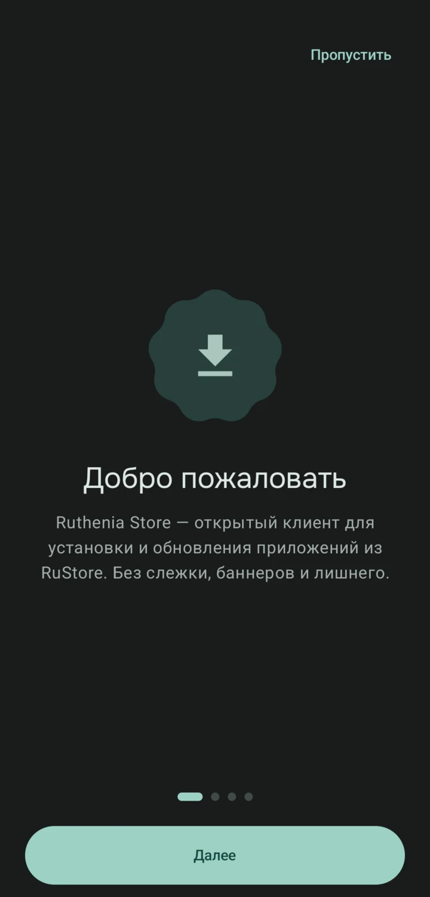
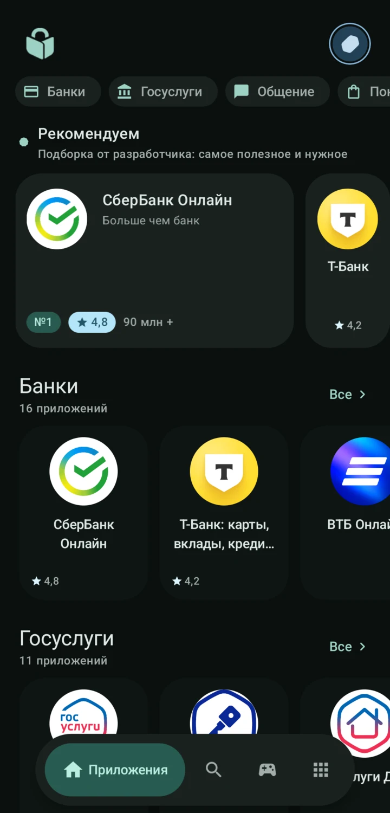
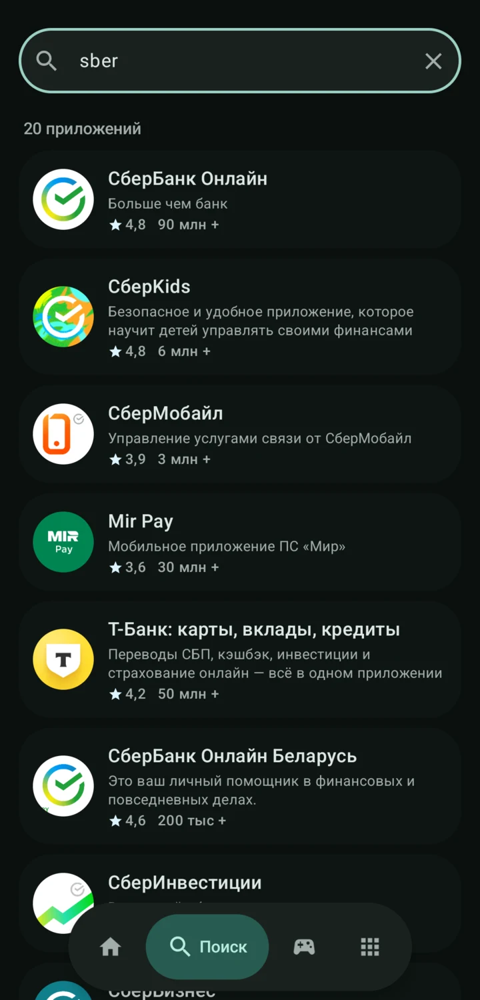
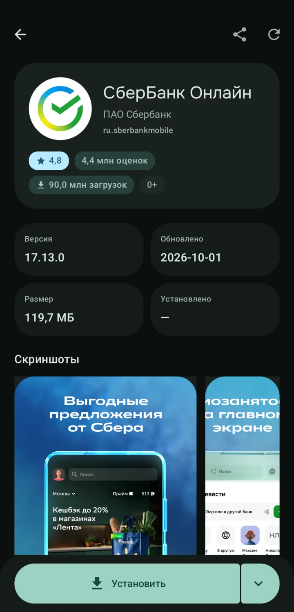
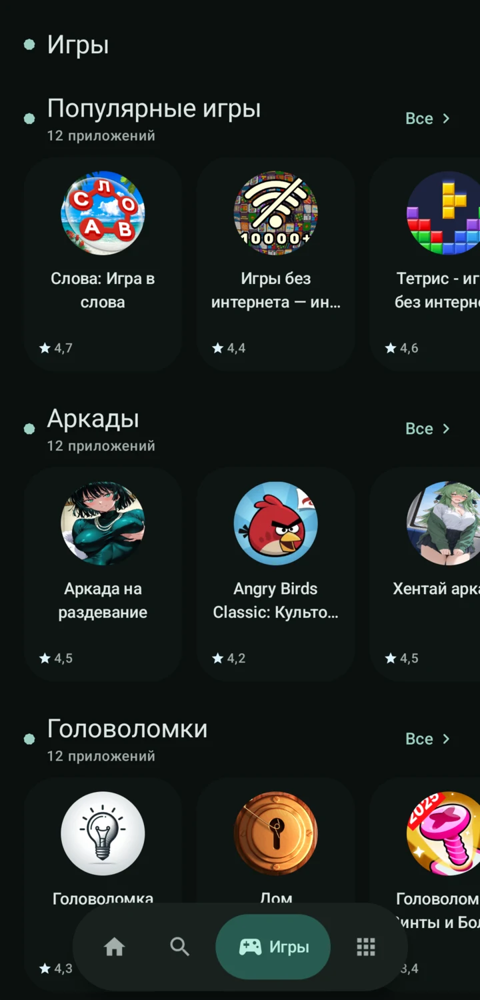
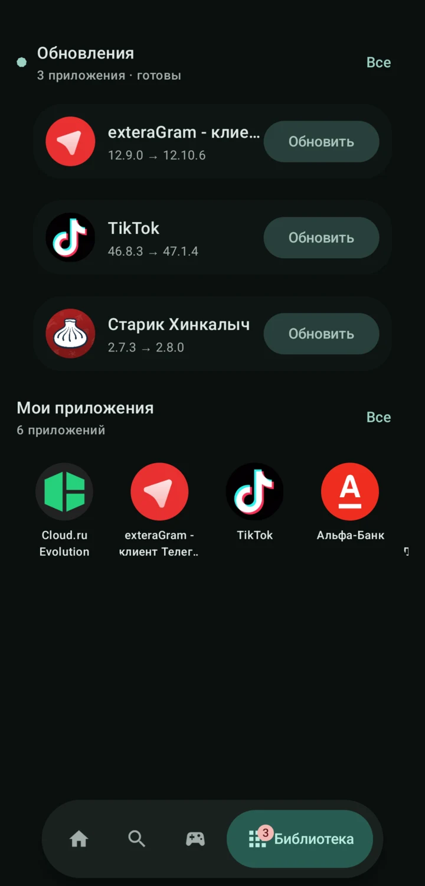
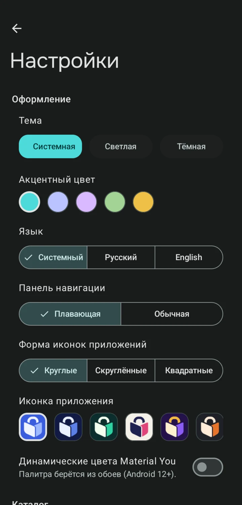
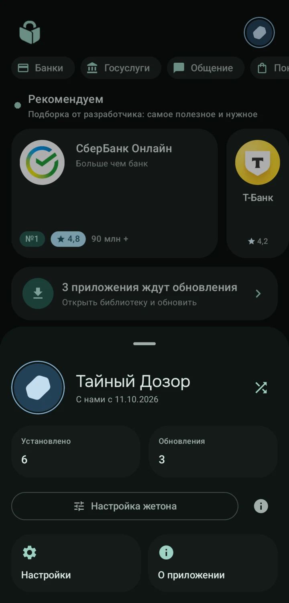

# Ruthenia Store

[](LICENSE)
[](https://kotlinlang.org)
[](https://developer.android.com)

[English version is here!](README.md)

**Лёгкий приватный клиент RuStore. Написан с нуля. Без слежки, без рекламы, без лишнего.**

Ruthenia Store позволяет устанавливать и обновлять приложения из каталога RuStore (банки, госуслуги и другие отечественные сервисы) без официального приложения — никаких трекеров, навязчивых обновлений и захламлённого интерфейса.

---

## Скачать

Последний APK — на [странице релизов](https://github.com/venterum/ruthenia/releases). Требуется Android 8.0 (API 26) или новее.

---

## Что есть в этом клиенте?

- **Поиск** по каталогу RuStore по названию или package name
- **Лента приложений** — «Рекомендуем» + категорийные секции (банки, госуслуги, игры и т.д.)
- **Страница игр** — популярные игры и жанровые ленты (можно скрыть в настройках)
- **Карточка приложения** — скриншоты, «что нового», рейтинг, «Ещё от разработчика»
- **Установка и обновления** — поддержка split-APK, одна инсталляционная сессия, фоновая загрузка через WorkManager
- **Тихая установка через Shizuku** — опционально ставит APK без системного диалога (по умолчанию выключена, проверка подписи сохраняется)
- **Жетон устройства** — локальная идентичность (имя, мотив, цвет, рамка) вместо аккаунта; никуда не отправляется
- **Иконка приложения** — выбор цвета иконки в настройках; тематические (monochrome) иконки продолжают работать
- **Библиотека** — установленные приложения со статусом обновлений, пакетное обновление, импорт с устройства
- **Обновление сертификатов** — ручная сверка SPKI-пинов с живыми цепочками RuStore и официальным CA Минцифры
- **Приватность ante omnia** — никакой аналитики, крашлитиков, рекламных SDK, анонимная работа, проверка подписи при каждом обновлении

---

## Скриншоты

<table>
  <tr>
    <td align="center"><a href="docs/screenshots/ru/01-onboarding.webp"></a><br><sub>Онбординг</sub></td>
    <td align="center"><a href="docs/screenshots/ru/02-home.webp"></a><br><sub>Лента</sub></td>
    <td align="center"><a href="docs/screenshots/ru/03-search.webp"></a><br><sub>Поиск</sub></td>
    <td align="center"><a href="docs/screenshots/ru/04-app.webp"></a><br><sub>Карточка приложения</sub></td>
  </tr>
  <tr>
    <td align="center"><a href="docs/screenshots/ru/05-games.webp"></a><br><sub>Игры</sub></td>
    <td align="center"><a href="docs/screenshots/ru/06-library.webp"></a><br><sub>Библиотека и обновления</sub></td>
    <td align="center"><a href="docs/screenshots/ru/07-settings.webp"></a><br><sub>Настройки</sub></td>
    <td align="center"><a href="docs/screenshots/ru/08-token.webp"></a><br><sub>Жетон</sub></td>
  </tr>
</table>

Те же экраны на английском — в [README.md](README.md) (`docs/screenshots/en/`).

---

## Сборка с нуля

```bash
# Debug APK
./gradlew :app:assembleDebug

# Release APK (~3,3 МБ, R8)
./gradlew :app:assembleRelease

# Юнит-тесты (91 тест, без сети)
./gradlew testDebugUnitTest
```

**Требования:** JDK 17, Android SDK 37 (compile/target), minSdk 26

---

## Документация

| Документ | Описание |
|----------|----------|
| [CONTRIBUTING](docs/ru/CONTRIBUTING.md) | Сборка, стиль, правила PR |
| [PRIVACY](docs/ru/PRIVACY.md) | Практики работы с данными и разрешения |
| [SECURITY](docs/ru/SECURITY.md) | Сообщение об уязвимостях |
| [Fastlane metadata](fastlane/metadata/android/) | Описание приложения |

**Не забывайте, что это неофициальный клиент**, который работает поверх реверс-инжиниренного API RuStore (у которого нет публичной документации). Фактически, это означает, что он может перестать работать при смене API.

---

## Лицензия

GPL-3.0-or-later. См. [LICENSE](LICENSE).

Логика сетевого слоя опирается на анализ [Obtainium](https://github.com/ImranR98/Obtainium) (GPL-3.0), файл `lib/app_sources/rustore.dart`.
